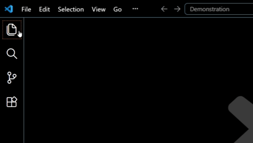
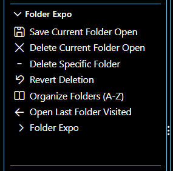

# **Folder Expo**
VS Code Explorer-Based Extension for quickly switching between & managing folders.

 

## **Video Demonstrations**

### Saving & Loading a new Folder &nbsp;&nbsp;&nbsp; (**Version 0.0.1** *Older*)

<!--
[TO DO:]
	Shoot updated Demo videos/Create GIFS of the content below (integrate/uncomment when done)

### Saving & Loading a Folder

### Deleting the Current Folder Opened

### Deleting a Specific Folder

### Organizing Folders (A-Z)

### Revert Deletion

-->

*Updated Video Demonstrations Coming Soon!*

 

## **Screenshot of Updated Functionality**

### Program Functionality &nbsp;&nbsp;&nbsp; (**Version 0.5.0** *Latest*)

 

## Questions & Annwers

 Does **Delete Current Folder Open** &nbsp; and &nbsp; **Delete Specific Folder** mean those folders will be deleted from my computer?

- **No**  &nbsp; *Delete Current Folder Open* &nbsp; and &nbsp; *Delete Specific Folder*  means to Add or remove the folder's reference to the Dropdown list 'Folder Expo'.  
It won't actually delete those folders from your computer itself (Some clarification for those who are unsure)

 

## Why I created this
I like to have extensions within the Explorer View & I find project managers to be helpful.  
There does not appear to be a similar extension on the marketplace (that I can find) so I made my own.
